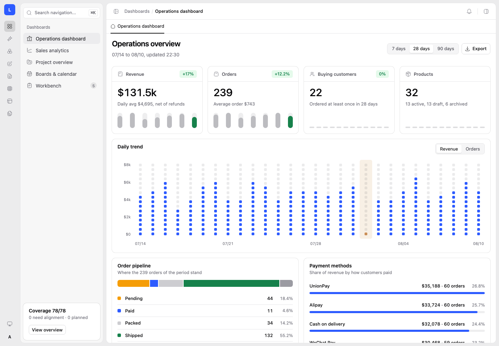

<h1 align="center">Lumi</h1>

<p align="center"><strong>JSON-driven admin apps. Built for AI.</strong></p>

<p align="center">
  <a href="https://www.npmjs.com/package/@duxweb/lumi"></a>
  <a href="https://github.com/duxweb/lumi/actions/workflows/ci.yml"></a>
  <a href="./LICENSE"></a>
</p>

<p align="center">
  <a href="https://duxweb.github.io/lumi/en/">Website</a> ·
  <a href="https://duxweb.github.io/lumi/guide/">Docs (中文)</a> ·
  <a href="https://duxweb.github.io/lumi/demo/">Live demo</a> ·
  <a href="https://duxweb.github.io/lumi/playground/">Playground</a>
</p>

<p align="center"><strong>English</strong> · <a href="./README.zh-CN.md">简体中文</a></p>

Lumi is a React framework for admin apps built on native [json-render](https://json-render.dev). Your backend serves pages, menus and data over JSON/HTTP; Lumi supplies the components, application services and Admin shell. Developers and AI agents work with the same component Catalog and validation rules.

Use the prebuilt Admin base to serve JSON pages without a frontend build, or import the packages into your own React application.

<a href="https://duxweb.github.io/lumi/demo/">
  <picture>
    <source media="(prefers-color-scheme: dark)" srcset="./.github/assets/readme/dashboard-en-dark.png" />
    
  </picture>
</a>

<p align="center">A real Lumi Admin, in light and dark themes. <a href="https://duxweb.github.io/lumi/demo/">Try it in your browser</a> — demo data runs locally, with no sign-in required.</p>

## What Lumi provides

- **Pages from JSON.** Native Spec, Catalog, Registry and StateStore, with bindings and registered actions. Connect any backend that speaks JSON/HTTP, including Go, PHP and Node.js.
- **A complete Admin shell.** Sign-in, permissions, menus, tabs, workspaces, routed drawers, responsive layouts and theme switching, with dashboard, list, form, detail and settings pages.
- **One UI for JSON and JSX.** React components with shared design tokens, forms, tables, filters, uploads and optional charts. Use Lumi UI on its own or as part of Admin.
- **Shared application services.** Hooks and JSON actions use the same data providers, query cache, authentication and upload lifecycle. Forms support async validation, field errors, drafts and unsaved-change guards.
- **Tools for AI authors.** A project-local Lumi skill and `lumi-check` let coding agents discover components, inspect props and validate pages against the application's Catalog.
- **An assistant inside the app.** Connect your chat endpoint for page context, record mentions, commands, approval cards and change previews. Your backend supplies the model integration.

## Get started

### Serve the prebuilt Admin

Load the bundled script and stylesheet from your backend's HTML page:

```html
<link
  rel="stylesheet"
  href="https://cdn.jsdelivr.net/npm/@duxweb/lumi-admin@0.1.0/dist/base/lumi-admin.css"
/>
<div id="app"></div>
<script
  type="module"
  src="https://cdn.jsdelivr.net/npm/@duxweb/lumi-admin@0.1.0/dist/base/lumi-admin.js"
  data-config="/config.json"
></script>
```

`config.json` connects the backend and manifest. The manifest defines menus and routes; routes load page Specs from JSON files or endpoints. The base includes React and the Lumi packages, so this path needs no Node.js installation or frontend build.

Follow the [complete quick start](https://duxweb.github.io/lumi/guide/getting-started/) for the four files and login endpoints. See the [backend contract](https://duxweb.github.io/lumi/guide/backend/) to connect your data API, and the [base example](./examples/base-admin/) for extension modules.

### Create a React project

With Node.js 22.12+ and pnpm:

```sh
pnpm create @duxweb/lumi my-app --pm pnpm
cd my-app
pnpm dev
```

The starter includes Lumi services, Lumi UI, a native Spec, a shared Catalog and the Lumi skill. It starts as a minimal page; add `@duxweb/lumi-admin` when you need the full Admin shell. Existing React applications can follow the [integration guide](https://duxweb.github.io/lumi/guide/advanced/react/).

## A page is a JSON Spec

Save this as `page.json`. The card reads its title from state; clicking the button updates it through the native `setState` action:

```json
{
  "state": { "title": "Hello, Lumi" },
  "root": "home",
  "elements": {
    "home": {
      "type": "Card",
      "props": { "title": { "$state": "/title" } },
      "children": ["button"]
    },
    "button": {
      "type": "Button",
      "props": { "label": "Update title" },
      "on": {
        "press": {
          "action": "setState",
          "params": { "statePath": "/title", "value": "Updated from JSON" }
        }
      },
      "children": []
    }
  }
}
```

Open the [Playground](https://duxweb.github.io/lumi/playground/) to validate and render it. Add `Query` and Lumi's request or CRUD actions to connect pages to your backend. See [page Specs](https://duxweb.github.io/lumi/guide/pages/) and [data interactions](https://duxweb.github.io/lumi/guide/data/) for complete examples.

## Author with AI

Look up the available components, inspect their props, then validate the page:

```sh
pnpm dlx @duxweb/lumi-check catalog
pnpm dlx @duxweb/lumi-check describe Card
pnpm dlx @duxweb/lumi-check page.json
```

The CLI uses the Admin Catalog by default. For custom components and actions, pass `--catalog ./catalog.mjs` to use your application's Catalog. The runtime and CLI validate against the same definitions.

The scaffold includes the [Lumi skill](./.claude/skills/lumi/SKILL.md) for coding agents. See the [AI authoring guide](https://duxweb.github.io/lumi/ai/) for the workflow, and [in-app assistants](https://duxweb.github.io/lumi/guide/assistant/) to connect an assistant to your backend.

## Packages

Choose the layer your application needs:

| Package | Role |
| --- | --- |
| [`@duxweb/lumi`](https://www.npmjs.com/package/@duxweb/lumi) | Services, React hooks and providers, request/CRUD handlers, Spec loading and validation. |
| [`@duxweb/lumi-ui`](https://www.npmjs.com/package/@duxweb/lumi-ui) | React components, the native UI registry, compiled CSS and optional charts. |
| [`@duxweb/lumi-admin`](https://www.npmjs.com/package/@duxweb/lumi-admin) | Admin shell, routing, page components and the prebuilt base. |
| [`@duxweb/lumi-check`](https://www.npmjs.com/package/@duxweb/lumi-check) | Catalog lookup, component descriptions and document validation from the CLI. |
| [`@duxweb/create-lumi`](https://www.npmjs.com/package/@duxweb/create-lumi) | React project scaffolding with a shared Catalog and the Lumi skill. |

Lumi's UI and application runtime use React. The framework-free `/catalog` subpaths support Node.js tools and server-side validation without React.

## Explore

| Resource | What to find |
| --- | --- |
| [Documentation](https://duxweb.github.io/lumi/guide/) | Setup, backend APIs, configuration and deployment. The guide is currently in Simplified Chinese. |
| [Components](https://duxweb.github.io/lumi/components/) | Component props, events, slots and live previews. |
| [Playground](https://duxweb.github.io/lumi/playground/) | Edit, validate, render and share native Specs. |
| [Live demo](https://duxweb.github.io/lumi/demo/) | The full Admin with data stored in your browser. |
| [Examples](./examples/) | Prebuilt base, native React integration and backend-driven Admin. |
| [Releases](https://github.com/duxweb/lumi/releases) | Published versions and release notes. |

## Contributing

Use Node.js 22.12+ and pnpm 9.15.4 to work on the monorepo:

```sh
git clone https://github.com/duxweb/lumi.git
cd lumi
pnpm install
pnpm site:dev
```

The local site opens at <http://127.0.0.1:5179>. For the Admin demo, package boundaries and checks, see [CONTRIBUTING.md](./CONTRIBUTING.md) and the [architecture plan](./plan/README.md).

Versions are managed with Changesets. Stable version tags trigger full CI, npm trusted publishing and a matching GitHub Release; pushes to `main` update the website, docs, Playground and demo together.

## License

[MIT](./LICENSE) · DuxWeb
