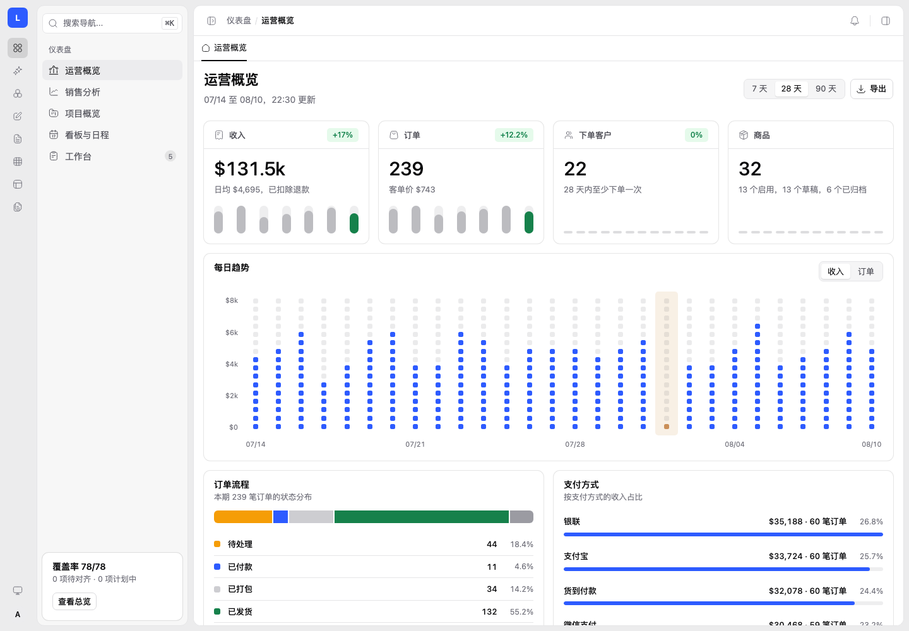

<h1 align="center">Lumi</h1>

<p align="center"><strong>用 JSON 构建后台，为 AI 开发而设计。</strong></p>

<p align="center">
  <a href="https://www.npmjs.com/package/@duxweb/lumi"></a>
  <a href="https://github.com/duxweb/lumi/actions/workflows/ci.yml"></a>
  <a href="./LICENSE"></a>
</p>

<p align="center">
  <a href="https://duxweb.github.io/lumi/">官网</a> ·
  <a href="https://duxweb.github.io/lumi/guide/">使用文档</a> ·
  <a href="https://duxweb.github.io/lumi/demo/">在线演示</a> ·
  <a href="https://duxweb.github.io/lumi/playground/">Playground</a>
</p>

<p align="center"><a href="./README.md">English</a> · <strong>简体中文</strong></p>

Lumi 是基于原生 [json-render](https://json-render.dev) 的 React 后台前端框架。后端通过 JSON/HTTP 提供页面、菜单和数据，Lumi 提供组件、应用服务和完整的 Admin 外壳。开发者与 AI 使用同一份组件目录和校验规则来编写页面。

使用预构建 Admin 基座，可以直接下发 JSON 页面，省去前端构建；也可以把各个包引入自己的 React 项目。

<a href="https://duxweb.github.io/lumi/demo/">
  <picture>
    <source media="(prefers-color-scheme: dark)" srcset="./.github/assets/readme/dashboard-zh-CN-dark.png" />
    
  </picture>
</a>

<p align="center">真实运行的 Lumi Admin，支持明暗主题。<a href="https://duxweb.github.io/lumi/demo/">打开在线演示</a>即可体验，无需登录，演示数据保存在浏览器中。</p>

## Lumi 提供什么

- **用 JSON 描述页面。** 沿用原生 Spec、Catalog、Registry 和 StateStore，通过状态绑定与注册动作实现交互。后端只需提供 JSON/HTTP 接口，Go、PHP、Node.js 等均可接入。
- **完整的后台外壳。** 登录、权限、菜单、标签页、工作区、路由抽屉、响应式布局和主题切换，配套仪表盘、列表、表单、详情与设置页。
- **JSON 与 JSX 共用 UI。** React 组件使用统一的设计 Token，覆盖表单、表格、筛选、上传和可选图表。Lumi UI 可以独立使用，也可以随 Admin 一起使用。
- **共用的应用服务。** Hooks 与 JSON 动作使用同一套数据提供者、查询缓存、认证和上传流程。表单支持异步校验、字段错误、草稿和未保存离开拦截。
- **面向 AI 的开发工具。** 项目内置的 Lumi skill 与 `lumi-check` 帮助编码 Agent 查组件、看属性，并按应用的 Catalog 校验页面。
- **后台里的 AI 助手。** 连接自己的对话接口，提供页面上下文、记录引用、快捷命令、审批卡片和变更预览；模型调用由你的后端实现。

## 快速开始

### 直接使用预构建 Admin

在后端的 HTML 页面中引入基座脚本和样式：

```html
<link
  rel="stylesheet"
  href="https://cdn.jsdelivr.net/npm/@duxweb/lumi-admin@0.1.0/dist/base/lumi-admin.css"
/>
<div id="app"></div>
<script
  type="module"
  src="https://cdn.jsdelivr.net/npm/@duxweb/lumi-admin@0.1.0/dist/base/lumi-admin.js"
  data-config="/config.json"
></script>
```

`config.json` 配置后端地址和 manifest。Manifest 定义菜单、路由，每个路由从 JSON 文件或接口加载页面 Spec。基座已经包含 React 和 Lumi 各层能力，这种接入方式不需要安装 Node.js，也不需要构建前端。

按[完整入门指南](https://duxweb.github.io/lumi/guide/getting-started/)准备四个文件和登录接口，即可运行。通过[数据接口约定](https://duxweb.github.io/lumi/guide/backend/)接入业务后端，扩展模块的用法见[基座示例](./examples/base-admin/)。

### 创建 React 项目

准备 Node.js 22.12+ 和 pnpm：

```sh
pnpm create @duxweb/lumi my-app --pm pnpm
cd my-app
pnpm dev
```

脚手架包含 Lumi 服务、Lumi UI、原生 Spec、共享 Catalog 和 Lumi skill，默认生成一个最小页面。需要完整后台外壳时，再加入 `@duxweb/lumi-admin`。已有 React 项目可参考[接入指南](https://duxweb.github.io/lumi/guide/advanced/react/)。

## 一份 JSON 就是一个页面

将下面内容保存为 `page.json`。卡片从状态中读取标题，点击按钮后，原生 `setState` 动作会更新标题：

```json
{
  "state": { "title": "你好，Lumi" },
  "root": "home",
  "elements": {
    "home": {
      "type": "Card",
      "props": { "title": { "$state": "/title" } },
      "children": ["button"]
    },
    "button": {
      "type": "Button",
      "props": { "label": "更新标题" },
      "on": {
        "press": {
          "action": "setState",
          "params": { "statePath": "/title", "value": "标题已通过 JSON 更新" }
        }
      },
      "children": []
    }
  }
}
```

在 [Playground](https://duxweb.github.io/lumi/playground/) 中粘贴后即可校验和运行。通过 `Query`、请求动作和 CRUD 动作，还能让页面直接连接后端。完整示例见[页面 JSON](https://duxweb.github.io/lumi/guide/pages/)与[读取数据](https://duxweb.github.io/lumi/guide/data/)。

## 与 AI 一起开发

先查目录，再看属性，最后校验页面：

```sh
pnpm dlx @duxweb/lumi-check catalog
pnpm dlx @duxweb/lumi-check describe Card
pnpm dlx @duxweb/lumi-check page.json
```

CLI 默认使用 Admin Catalog。添加自定义组件和动作时，传入 `--catalog ./catalog.mjs`，即可按应用实际使用的 Catalog 查询和校验。运行时与 CLI 共用同一份定义。

脚手架会为编码 Agent 生成项目级 [Lumi skill](./.claude/skills/lumi/SKILL.md)。编写页面的流程见 [AI 开发指南](https://duxweb.github.io/lumi/ai/)，接入后台对话能力见 [AI 助手](https://duxweb.github.io/lumi/guide/assistant/)。

## 包与分层

按应用需要选择对应层：

| 包 | 职责 |
| --- | --- |
| [`@duxweb/lumi`](https://www.npmjs.com/package/@duxweb/lumi) | 应用服务、React hooks 与 Provider、请求与 CRUD handlers、Spec 加载和校验。 |
| [`@duxweb/lumi-ui`](https://www.npmjs.com/package/@duxweb/lumi-ui) | React 组件、原生 UI Registry、编译后的 CSS 和可选图表。 |
| [`@duxweb/lumi-admin`](https://www.npmjs.com/package/@duxweb/lumi-admin) | 后台外壳、路由、页面组件和预构建基座。 |
| [`@duxweb/lumi-check`](https://www.npmjs.com/package/@duxweb/lumi-check) | 命令行查目录、查组件详情和校验文档。 |
| [`@duxweb/create-lumi`](https://www.npmjs.com/package/@duxweb/create-lumi) | React 项目脚手架，包含共享 Catalog 和 Lumi skill。 |

Lumi 的界面和应用运行时使用 React。各包的 `/catalog` 子路径保持框架无关，可在未安装 React 的 Node.js 环境中供工具与服务端校验使用。

## 继续探索

| 入口 | 内容 |
| --- | --- |
| [使用文档](https://duxweb.github.io/lumi/guide/) | 安装、后端接口、项目配置与部署。 |
| [组件目录](https://duxweb.github.io/lumi/components/) | 属性、事件、插槽和可交互的组件预览。 |
| [Playground](https://duxweb.github.io/lumi/playground/) | 编辑、校验、渲染和分享原生 Spec。 |
| [在线演示](https://duxweb.github.io/lumi/demo/) | 完整后台，数据保存在浏览器中。 |
| [示例项目](./examples/) | 预构建基座、原生 React 接入与后端 JSON 驱动的后台。 |
| [版本发布](https://github.com/duxweb/lumi/releases) | 已发布的版本与更新记录。 |

## 参与开发

仓库开发环境为 Node.js 22.12+、pnpm 9.15.4：

```sh
git clone https://github.com/duxweb/lumi.git
cd lumi
pnpm install
pnpm site:dev
```

本地站点地址为 <http://127.0.0.1:5179>。后台示例的启动方式、包的职责与检查命令，见[贡献指南](./CONTRIBUTING.md)和[架构方案](./plan/README.md)。

版本由 Changesets 管理，正式版本标签会触发完整 CI、npm 可信发布和对应的 GitHub Release。推送到 `main` 时，官网、文档、Playground 与演示会作为一体站自动更新。

## 许可证

[MIT](./LICENSE) · DuxWeb
