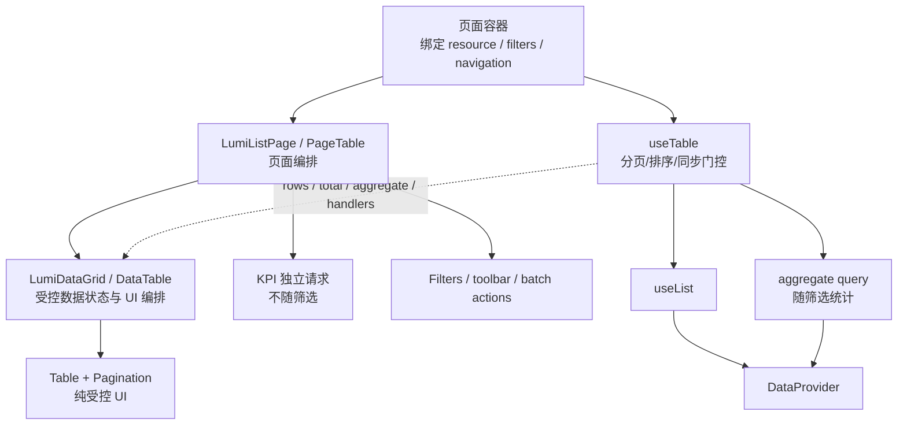
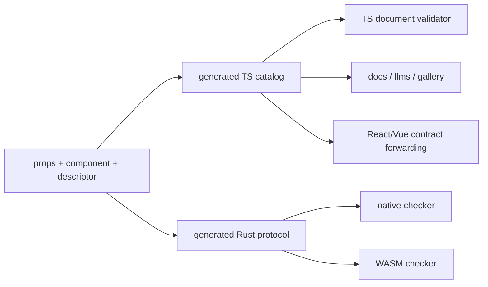
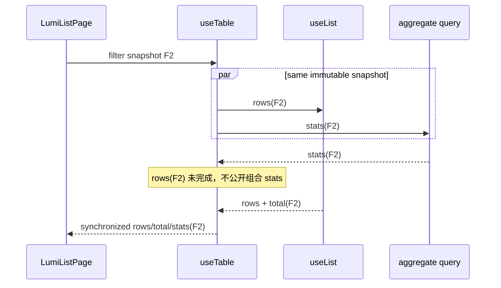
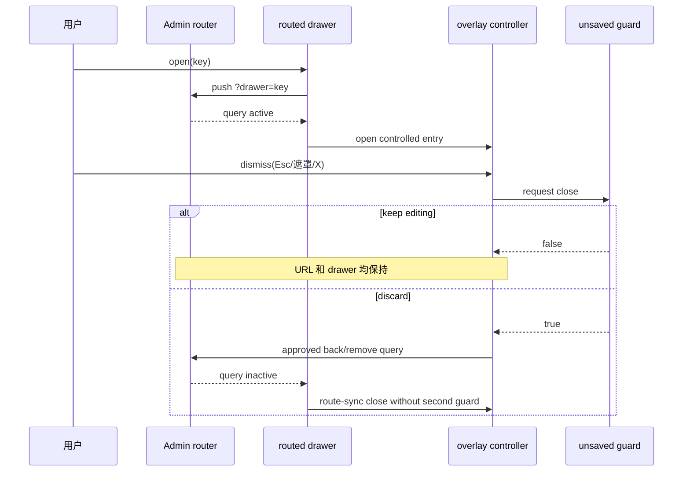

# Lumi 非视觉页面能力架构图

Status: confirmed
Last updated: 2026-08-11
Scope: 七项非视觉能力的模块关系与关键一致性时序
Confirmation: 用户于 2026-08-10 授权连续实施并确认表格三层职责
Document language: 中文

## Diagram decision

表格三层依赖、筛选双查询一致性和 routed drawer/dirty guard 时序涉及三个以上边界，图示能避免把 UI、数据与页面职责混在一起。

## 表格三层模块

Links: ARC-202, NFR-201

## 协议生成链

Links: ARC-201

## 同筛选快照时序

Links: ARC-202
Failure/consistency notes: 任一请求失败时不混用旧 snapshot；resource invalidation 同时命中两类 query key。

## Drawer 与 dirty guard 时序

Links: ARC-204
Failure/consistency notes: direct shared URL 的关闭使用 replace 去掉 query，避免离站；由本页 open 创建的 history entry 使用 back。
